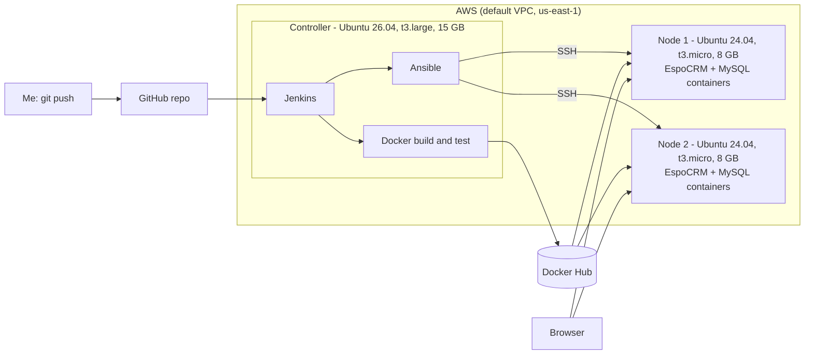

# EspoCRM DevOps Project

A complete DevOps pipeline that builds, tests and deploys the open-source
[EspoCRM](https://www.espocrm.com) web application to servers on AWS, fully automated.

I started with a plain GitHub repo and ended with this flow: **I push code, Jenkins builds
a Docker image, and Ansible puts the new version live on two servers.**

---

## What does this project do? (in simple terms)

EspoCRM is a CRM, a program companies use to keep track of customers. Running it by hand
means setting up servers, installing software and copying files over and over. This project
automates all of that:

1. **Terraform** creates the servers on AWS (the "building").
2. **Jenkins** picks up my code from GitHub, packs it into a Docker image and tests it
   (the "factory").
3. **Docker Hub** stores the finished image (the "warehouse").
4. **Ansible** installs Docker on the servers and starts the app plus its database
   (the "delivery team").

---

## Architecture



---

## Tools used

| Tool | What it does here |
|---|---|
| **Terraform** | Creates the 3 EC2 servers, security groups (firewalls) and the Ansible inventory file |
| **Jenkins** | The CI/CD engine: runs the pipeline on every build |
| **Docker** | Packages EspoCRM and everything it needs into one image |
| **Docker Hub** | Stores the image so the servers can download it |
| **Ansible** | Configures the servers and runs the containers on them |
| **AWS EC2** | The servers |
| **MySQL 8** | EspoCRM's database (runs in its own container) |
| **Git / GitHub** | Stores the code and triggers the whole flow |

---

## What is in this repo

```
.
├── Dockerfile               # builds EspoCRM from source (multi-stage) on PHP 8.3 + Apache
├── docker-compose.yml       # run everything locally for testing
├── Jenkinsfile              # the pipeline: build, test, push, deploy
├── terraform/
│   ├── main.tf              # servers, firewalls, inventory file
│   ├── variable.tf          # sizes, region, key name, my IP
│   └── inventory.tftpl      # template for the Ansible inventory
├── scripts/
│   └── install_jenkins_docker.sh   # installs Java, Jenkins, Docker, Ansible on the controller
└── ansible/
    ├── ansible.cfg          # Ansible settings
    ├── inventory.ini        # list of the 2 nodes (generated by Terraform)
    └── deploy.yml           # playbook: installs Docker, runs MySQL + EspoCRM, cron, swap
```

---

## The servers

| Server | OS | Size | Disk | Job |
|---|---|---|---|---|
| Controller | Ubuntu 26.04 | t3.large | 15 GB | Runs Jenkins, Docker and Ansible |
| Node 1 | Ubuntu 24.04 | t3.micro | 8 GB | Runs EspoCRM + MySQL |
| Node 2 | Ubuntu 24.04 | t3.micro | 8 GB | Runs EspoCRM + MySQL |

All use the default VPC and the key pair `serverkey`.

---

## How the pipeline works

Every time I click **Build Now** (or push code), Jenkins runs these stages:

1. **Checkout**: downloads the latest code from GitHub.
2. **Build Docker image**: builds EspoCRM from source into an image.
3. **Smoke test**: starts the image and checks PHP and the database driver are there.
4. **Push to Docker Hub**: uploads the image with the build number as its tag.
5. **Deploy with Ansible**: connects to both nodes, pulls the new image and restarts EspoCRM.

---

## How to run it yourself

**You need:** an AWS account with the AWS CLI set up, Terraform, Git, a Docker Hub account,
and an EC2 key pair called `serverkey`.

1. **Fork this repo** and clone it.
2. **Set your values:** your Docker Hub username in `Jenkinsfile` and `ansible/deploy.yml`,
   and your own database passwords in `ansible/deploy.yml`.
3. **Create the servers:**
   ```bash
   cd terraform
   cp terraform.tfvars.example terraform.tfvars   # put your public IP, e.g. 1.2.3.4/32
   terraform init
   terraform apply
   ```
4. **Wait about 5 minutes**, then SSH into the controller and check
   `/var/log/install_tools.log` for "install complete".
5. **Copy `serverkey.pem`** to `~/.ssh/` for both the `ubuntu` and `jenkins` users on the
   controller, then test Ansible with `ansible all -m ping`.
6. **Set up Jenkins** at `http://<controller-ip>:8080`: install the suggested plugins, add a
   Docker Hub credential with the ID `dockerhub-creds`, and create a Pipeline job from SCM
   that points at this repo with the script path `Jenkinsfile`.
7. **Click Build Now.** When it finishes, open `http://<node-ip>` and run the EspoCRM
   installer. Use the database host `espocrm-db`.

**To remove everything** and stop AWS charges: `cd terraform && terraform destroy`.

---

## Problems I ran into and how I fixed them

Real projects break. These are the issues I solved:

| Problem | Cause | Fix |
|---|---|---|
| Docker build failed at `grunt` | EspoCRM needs the PHP `sockets` extension, which was missing | Added the extension to the Dockerfile |
| Pipeline failed in the Ansible stage | A YAML indentation mistake in `deploy.yml` | Fixed the spacing |
| SSH and Jenkins suddenly timed out | My home IP address changed, so the firewall blocked me | Updated `my_ip_cidr` and re-ran `terraform apply` |
| EspoCRM setup wizard showed errors and "MySQL server has gone away" | MySQL was killed for running out of memory on a 1 GB t3.micro | Added a swap file and lowered MySQL's memory use |
| "No space left on device" | The 8 GB disk was nearly full | Pruned old Docker images and used a smaller swap file |
| Could not log in to one node | Each node has its own database and admin account | Reset the password with EspoCRM's `set-password` command |

---

## What I learned

- How Terraform, Jenkins, Docker and Ansible fit together into one automated flow.
- How to read logs (Jenkins, Docker, kernel) to find the real cause of a failure.
- That small servers need memory and disk planning, and that cloud firewalls depend on your IP.
- Why passwords should not live in a public repo (next step: Ansible Vault or Jenkins credentials).

---

## Ideas for next steps

- Trigger the pipeline automatically with a GitHub webhook.
- Move the passwords to Ansible Vault or Jenkins credentials.
- Put a load balancer in front of the two nodes.
- Use one shared database instead of one per node.
- Add Terraform and Ansible lint checks to the pipeline.

---

## Author

Bede (GitHub: [Bedeneche](https://github.com/Bedeneche))
